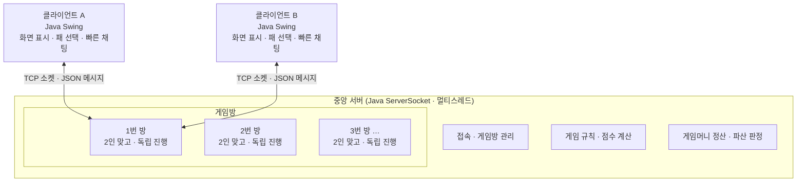

# 🎴 갈래? 말래?

> Java Swing과 TCP 소켓으로 구현하는 2인 맞고 게임
> 네트워크 프로그래밍 기말 프로젝트 · 팀 **갈래말래**


---

## 📑 목차

1. [프로젝트 개요](#-프로젝트-개요)
2. [게임 규칙 및 진행 순서](#-게임-규칙-및-진행-순서)
3. [시스템 구조](#-시스템-구조)
4. [기능 및 우선순위](#-기능-및-우선순위)
5. [개발 분담](#-개발-분담)
6. [개발 일정](#-개발-일정)
7. [팀원](#-팀원)
8. [오픈소스 및 라이선스](#-오픈소스-및-라이선스)

---

## 📌 프로젝트 개요

하나의 중앙 서버에 여러 사용자가 접속하여, **게임방별로 2인 맞고**를 즐기는 프로그램입니다.
한게임 신맞고의 화면 구성과 진행 방식을 참고하였으며, 스톱 시 정산 후 다음 판을 이어가고 **한 명이 파산할 때까지** 대결이 계속되는 것을 목표로 합니다.

| 항목 | 내용 |
| --- | --- |
| 진행 방식 | 접속 → 방 생성·입장 → 2명 입장 후 방장이 시작 → 게임 → 결과 표시 |
| 개발 환경 | Java · Swing · TCP Socket · 멀티스레드 |

---

## 🃏 게임 규칙 및 진행 순서

2인 맞고를 여러 판 진행하며, 한 명이 파산하면 대결을 종료합니다.

| 순서 | 단계 | 주요 규칙 |
| :---: | --- | --- |
| 1 | 입장 및 시작 | 2명이 입장하면 각자 게임머니 **100만 원**을 지급받고 게임을 시작한다. |
| 2 | 패 준비 및 분배 | 기본 화투 48장과 서비스패 3장을 섞어 손패 각 **10장**, 바닥패 **8장**으로 분배하고 나머지는 중앙 더미패로 둔다. |
| 3 | 차례 진행 | 손패를 내고 중앙 더미를 뒤집어 같은 월의 패를 획득한다. 두 사람이 번갈아 진행한다. |
| 4 | 점수 및 고·스톱 | 획득한 패로 점수를 계산하며, **7점 이상**에서 고 또는 스톱을 선택한다. |
| 5 | 중간 정산 | 스톱 시 최종 정산 점수에 **점당 1만 원**을 적용하여 게임머니를 정산한다. |
| 6 | 다음 판 및 종료 | 잔액을 유지한 채 다음 판을 진행하고, 한 명이 파산하면 대결을 종료한다. |

---

## 🏗 시스템 구조



**처리 흐름**

```
사용자 입력 → 서버 검증·처리 → 게임 상태 전달 → 화면 갱신
```

- 게임 상태는 **서버 메모리**에서 관리합니다.
- 각 클라이언트에는 자신에게 필요한 정보만 전달하며, **상대 손패는 공개하지 않습니다.**

---

## ✅ 기능 및 우선순위

### 필수

- [ ] 다중 접속 및 닉네임 설정, 대기실·방 목록, 방 생성·입장·퇴장 (정원 2명)
- [ ] 각 사용자에게 필요한 게임 상태·게임머니 전달, 상대 손패 비공개
- [ ] 패 분배·매칭·획득, 차례 및 서비스패 처리, 점수·족보 계산, 고·스톱 선택
- [ ] 최초 입장 시 게임머니 100만 원 지급, 점당 1만 원 정산 및 잔액 유지
- [ ] 스톱 후 다음 판 진행, 나가리 처리, 파산 판정 및 대결 종료
- [ ] 게임 중 추가 입장 제한, 연결 종료 및 잘못된 요청 처리
- [ ] 게임 중 빠른 채팅 (고!, 스톱!, 한 수 요 등)
- [ ] 특수 규칙: 뻑 · 쪽 · 따닥 · 싹쓸이 · 폭탄 · 흔들기 / 이벤트 연출, 재대결

### 확장

- [ ] 4인 입장 방 추가 고려

---

## 👥 개발 분담

| 파트 | 내용 |
| --- | --- |
| 서버 · 통신 | ServerSocket, 멀티스레드 접속 처리, 게임방 관리, 메시지 송수신 |
| 게임 로직 | 패 분배·매칭, 점수·족보 계산, 고·스톱, 정산·파산 판정 |
| Swing UI | 대기실·게임 화면, 패 선택, 빠른 채팅, 이벤트 연출 |

- 파트별 담당자는 팀 협의로 확정합니다.
- 규칙 및 메시지 형식 설계, 기능 통합 및 테스트는 **공동으로** 진행합니다.
- Java 객체 ↔ JSON 변환은 **Gson**을 사용하고, 게임 로직과 소켓 통신은 직접 구현합니다.

---

## 📅 개발 일정

| 주차 | 주요 작업 |
| :---: | --- |
| 1주차 | 게임 규칙 · 화면 · 통신 메시지 설계 |
| 2주차 | 서버 접속, 대기실 및 게임방 구현 |
| 3주차 | 패 분배 · 매칭 · 획득, 차례 및 화면 동기화 구현 |
| 4주차 | 점수 · 고 · 스톱, 게임머니 정산 · 파산 판정 및 기능 통합 |
| 5주차 | 2인 플레이 및 연속 정산 테스트, 오류 수정, 확장 기능 및 시연 준비 |

> 총 5주를 기준으로 계획하며, 수업 일정과 개발 진행 상황에 따라 조정합니다.

---

## 🙋 팀원

**팀 갈래말래**

| 이름 | 담당 |
| --- | --- |
| 황선하 | 서버 프로토콜 개발 |
| 김하민 | 로직 기능 구현 |
| 정우진 | UI/UX 설계 및 채팅 프로토콜 개발 |

---

## 📜 오픈소스 및 라이선스

### 화투 이미지

- 이미지 세트: **Marcus Richert** — <https://www.marcusrichert.com/images/hwatu/>
- 원본 도안: **Louie Mantia, Jr.**
- 라이선스: [CC BY-SA 4.0](https://creativecommons.org/licenses/by-sa/4.0/)
- 변경 사항: _(크기 조정, 포맷 변환 등 변경한 내용이 있다면 여기에 기재)_

> CC BY-SA 4.0 조건에 따라, 위 이미지를 변경하여 사용하는 경우 변경된 이미지도 동일한 라이선스로 배포해야 합니다.

### 라이브러리

- [Gson](https://github.com/google/gson) — Apache License 2.0
